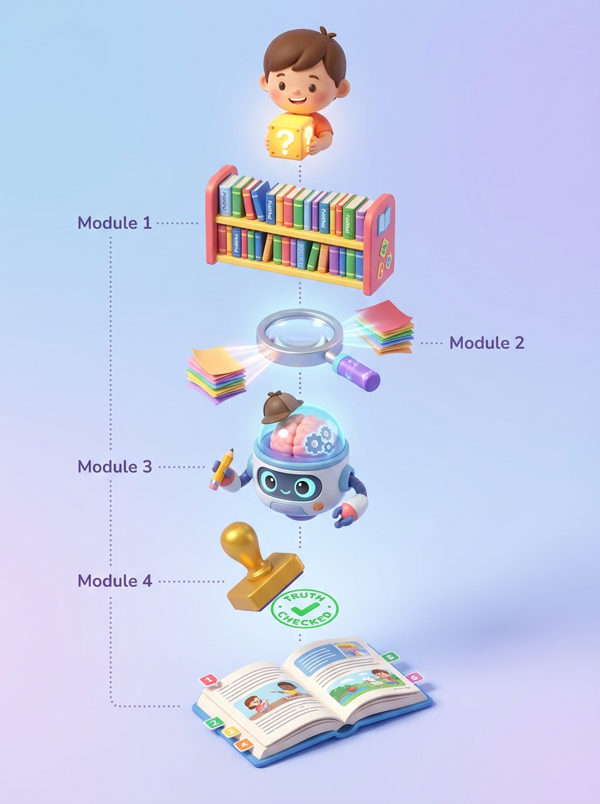
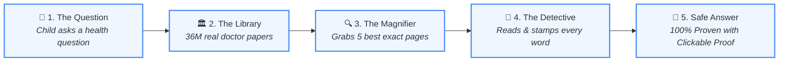

# EvidenceBot: The Robot That Never Tells Fibs 🤖📚
*A 1-Page Visual Story: How I Built a Super-Smart, 100% Honest Medical Detective*

---

### 1. The Big Problem: Why Did I Build This? 🎈
Imagine asking a normal robot: *"Does drinking blueberry juice cure a cold?"*  
Normal AI robots love to pretend they know everything. They make up convincing stories that sound smart, but are completely untrue! In medicine, making things up is dangerous.

> **💡 The Big Idea:**  
> What if we built a robot that is **strictly forbidden from guessing**? It must take an **open-book test** using only real books written by real doctors, and it must show you the exact page for every single sentence!

---

### 2. Exploded View: What's Inside the Toy Robot? 🔍

Here is EvidenceBot pulled apart into its modular pieces:

---

### 3. How It Works in 4 Simple Lego Blocks 🧱

| Block | Toy Name | What It Actually Does |
| :---: | :--- | :--- |
| **1** | **The Magic Listener** 👂 | Listens to your question and turns it into clean library search words. |
| **2** | **The Super Runner** 🏃‍♂️ | Runs straight into the US National Library of Medicine (PubMed) and brings back actual doctor studies. |
| **3** | **The Open-Book Reader** 📖 | Reads **only** those retrieved doctor pages. It has zero memory of its own, so it cannot make up fibs! |
| **4** | **The Truth Stamp** 🛡️ | Checks every sentence before printing:  • **Green Stamp**: 100% backed by real proof. • **Golden Rule**: If evidence is missing, it honestly says: *"Doctors haven't proven this yet!"* |

---

### 4. What Did I Actually Build? (The Secret Recipe) 🚀
1. **Zero Guesswork (Grounding):** Ordinary bots guess; EvidenceBot only speaks when it can point to real medical evidence.
2. **Honest Abstention:** If the research is missing or conflicting, it never pretends. It tells you the truth: *"We don't know yet."*
3. **One-Click Proof Badges:** Every single fact includes a clickable blue badge opening the original paper on PubMed.
4. **Live Worldwide Access:** Packaged into a fast, beautiful website running worldwide in the cloud!

