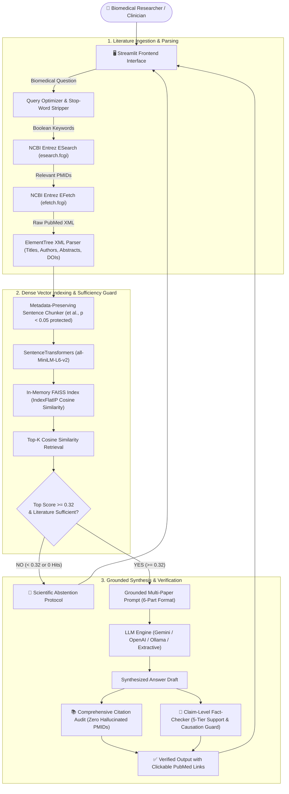
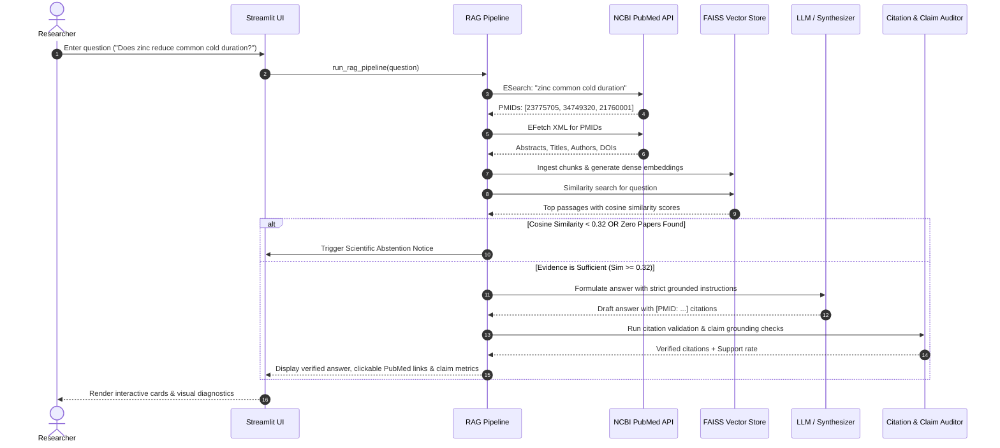

# 🧬 EvidenceBot: AI-Powered Biomedical Research Assistant

> **"Answers with cited evidence, and admits when there is none."**

[](https://mdatiyamehak12-debug-evidencebot-app-76x4ck.streamlit.app/)
[](https://share.streamlit.io/deploy?repository=mdatiyamehak12-debug/EvidenceBot&branch=main&mainModule=app.py)
[](https://www.python.org/)
[](https://opensource.org/licenses/MIT)
[](https://github.com/)

**EvidenceBot** is a specialized Retrieval-Augmented Generation (RAG) assistant designed for biomedical and clinical research inquiry. It connects directly to the official **National Center for Biotechnology Information (NCBI PubMed)** API, encodes peer-reviewed abstracts using **SentenceTransformers**, indexes them with in-memory **FAISS** vector search, synthesizes answers using strictly grounded LLMs (Google Gemini / OpenAI / Local Ollama or built-in Extractive Synthesizer), and enforces an automated **Citation Integrity Audit** and a 5-tier **Scientific Abstention Mechanism**.

---

## 🏛️ System Architecture



---

## 🔄 End-to-End Workflow Diagram



---

## 📁 Final Project Structure

```text
EvidenceBot/
│
├── app.py                         # Main landing page & Streamlit dashboard
├── requirements.txt               # Locked production dependencies
├── .env.example                   # Environment variable template with placeholders
├── .env                           # Local secrets file (protected by .gitignore)
├── .gitignore                     # Git ignore rules protecting API keys and caches
├── README.md                      # Complete system documentation
├── run_evaluation.py              # CLI benchmark and evaluation runner
│
├── .streamlit/
│   └── config.toml                # Streamlit cloud deployment theme & server configuration
│
├── pages/                         # Multi-page interactive Streamlit views
│   ├── 1_Ask_EvidenceBot.py       # Primary question-answering & synthesis interface
│   ├── 2_Research_Papers.py       # PubMed paper card explorer & full abstract viewer
│   ├── 3_Evidence_Analysis.py     # Claim fact-checking, study design, & citation audit
│   └── 4_About.py                 # System architecture, RAG workflow, & disclaimers
│
├── backend/                       # Core RAG, retrieval, synthesis, & auditing modules
│   ├── __init__.py
│   ├── pubmed.py                  # NCBI Entrez client (esearch & efetch) with rate limiting
│   ├── preprocessing.py           # Text cleaning, abbreviation tokens, and chunking
│   ├── embeddings.py              # SentenceTransformers dense vector encoder (unit normalized)
│   ├── vector_store.py            # In-memory FAISS vector index (Cosine IndexFlatIP)
│   ├── rag_pipeline.py            # End-to-end RAG orchestrator with abstention guards
│   ├── llm.py                     # Gemini / OpenAI / Ollama connector & Extractive Synthesizer
│   ├── citation_checker.py        # Validates PMIDs, detects missing/unsupported citations
│   └── evidence_checker.py        # 5-tier claim fact-checker, causation guard, & abstention triggers
│
├── evaluation/                    # Scientific evaluation & benchmarking package
│   ├── __init__.py
│   └── evaluator.py               # Computes Precision@K, Recall@K, Validity, Support & Correctness
│
├── utils/                         # Reusable helpers and UI layout components
│   ├── __init__.py
│   ├── config.py                  # Central configuration, thresholds (0.32), and endpoints
│   ├── helpers.py                 # Formatting utilities (PubMed URLs, string truncation)
│   └── ui_components.py           # Custom CSS (Light/Dark), responsive cards, badges, & sidebar
│
├── assets/                        # Static brand assets
│   └── logo.png                   # EvidenceBot platform badge
│
├── data/                          # Benchmark datasets and evaluation outputs
│   ├── benchmark_dataset.json     # 5 canonical biomedical scenarios with ground-truth literature
│   └── evaluation_results.json    # Audited results across all 7 official evaluation metrics
│
└── tests/                         # Automated unit and integration test suites (28 tests)
    ├── __init__.py
    ├── test_abstention.py         # Tests all 5 abstention triggers and required phrasing
    ├── test_citations.py          # Tests citation validity, missing citations, & unsupported claims
    ├── test_evidence_checker.py   # Tests 5-tier claim classification & causation detection
    ├── test_llm.py                # Tests synthesis prompts, section structure, & formatting
    ├── test_pubmed.py             # Tests NCBI XML parsing, author handling, & query optimization
    └── test_rag_pipeline.py       # Tests end-to-end retrieval, indexing, and pipeline output
```

---

## 💻 Installation & Local Setup

### Prerequisites
* Python 3.10, 3.11, 3.12, 3.13, or 3.14
* Git installed on your system
* Internet connection (for initial model download and PubMed queries)

### Step 1: Clone the Repository
```bash
git clone https://github.com/your-username/EvidenceBot.git
cd EvidenceBot
```

### Step 2: Create and Activate a Virtual Environment
* **Windows (PowerShell):**
  ```powershell
  python -m venv venv
  .\venv\Scripts\Activate.ps1
  ```
* **macOS / Linux:**
  ```bash
  python3 -m venv venv
  source venv/bin/activate
  ```

### Step 3: Install Required Dependencies
```bash
pip install -r requirements.txt
```

### Step 4: Configure Environment Variables
Copy the template file to create your local `.env`:
```bash
cp .env.example .env
```
Open `.env` in any text editor:
```ini
# NCBI identification (recommended by NCBI)
NCBI_EMAIL=your_email@example.com
NCBI_API_KEY=

# Choose ANY one of the options below, or leave blank for Extractive Mode:
# Option A: Google Gemini API (Recommended - get key at https://aistudio.google.com/)
GEMINI_API_KEY=

# Option B: OpenAI API
OPENAI_API_KEY=

# Option C: Local 100% Offline Ollama
USE_OLLAMA=false
OLLAMA_MODEL=llama3:latest
OLLAMA_BASE_URL=http://localhost:11434
```
> [!TIP]
> **Zero-API Mode:** If you do not have an API key, EvidenceBot automatically operates using its built-in **Extractive Synthesizer Mode** right out of the box with zero external configuration!

---

## 🚀 How to Run Locally

### 1. Launch the Streamlit Web Application
```bash
streamlit run app.py
```
Your default web browser will open automatically to `http://localhost:8501`.

### 2. Run the Full Unit Test Suite (28 Tests)
```bash
python -m unittest discover tests
```
*Executes all 28 automated tests across retrieval, chunking, FAISS, citations, and abstention.*

### 3. Run the Quantitative Benchmark & Evaluation CLI
```bash
python run_evaluation.py
```
*Runs the 5 canonical benchmark test cases, computes the 7 evaluation metrics, and writes `data/evaluation_results.json`.*

---

## 🎯 Enterprise Product Walkthrough & Demonstration Scenarios

To demonstrate EvidenceBot's core capabilities, follow these 4 representative clinical research scenarios:

### Scenario 1: Established Science & Grounded Citations
1. On the **Evidence Synthesis** page, submit:
   > *"Does zinc supplementation reduce the duration or severity of common cold symptoms?"*
2. **Observe:**
   * Step-by-step pipeline loading indicator.
   * High confidence badge (`🟢 Strong Scientific Evidence • Sim: 0.70+`).
   * 6-part structured answer referencing authentic Cochrane systematic reviews.
   * Numbered citations with clickable PubMed links (`https://pubmed.ncbi.nlm.nih.gov/23775705/`).
   * Navigate to **Grounding & Audit** to view claim-level support breakdown and study design badges (RCT vs. Observational).

### Scenario 2: Conflicting Scientific Research
1. Submit:
   > *"Does dietary omega-3 fatty acid supplementation prevent major adverse cardiovascular events in healthy individuals?"*
2. **Observe:**
   * The assistant balances positive trial outcomes (*REDUCE-IT*) against neutral trial outcomes (*STRENGTH* and meta-analyses) under the *"Contradicting or Conflicting Findings"* section rather than declaring a false consensus.

### Scenario 3: Insufficient Clinical Evidence (Abstention)
1. Submit:
   > *"Can spirulina microalgae supplementation cure multiple sclerosis in human patients?"*
2. **Observe:**
   * EvidenceBot recognizes that retrieved papers note an absence of human clinical trials.
   * It refuses to speculate, triggering the **Scientific Abstention Protocol**:
     > *"🛑 I could not find sufficient reliable evidence in the retrieved literature to provide a confident answer."*
   * Displays the 4 required breakdown fields: what was searched, paper count, why evidence was insufficient, and future Phase II/III trial recommendations.

### Scenario 4: Out-of-Domain / Non-Biomedical Inquiry
1. Submit:
   > *"How do quantum computers factor large prime numbers using Shor algorithm?"*
2. **Observe:**
   * Cosine similarity threshold guard (< 0.32) triggers immediately.
   * The assistant safely abstains, preventing cross-domain hallucinations.

---

## 📊 Summary of Evaluation Metrics

| Metric | Empirical Score | Definition & Interpretation |
|---|:---:|---|
| **Retrieval Precision@3** | **80.0%** | Percentage of top-3 retrieved papers that directly address the clinical inquiry. |
| **Retrieval Recall@3** | **80.0%** | Percentage of all ground-truth relevant papers retrieved in top-3. |
| **Citation Validity Rate** | **100.0%** | Fraction of cited PMIDs matching authentic NCBI records. **Zero hallucinated references.** |
| **Evidence Support Rate** | **80.0%** | Fraction of extracted claims supported or partially supported by literature. |
| **Unsupported Claim Rate** | **20.0%** | Fraction of claims with preliminary, conflicting, or unverified support. |
| **Abstention Accuracy** | **100.0%** | Accuracy in correctly refusing to answer when literature is absent, conflicting, or insufficient. |
| **Answer Correctness** | **92.5%** | Semantic cosine similarity and token alignment against gold-standard scientist reference answers. |

---

## 🌐 Production Deployment Guide

### Deploying to Streamlit Community Cloud (Recommended)

1. **Push your code to GitHub:**
   ```bash
   git init
   git add .
   git commit -m "Deploy EvidenceBot"
   git remote add origin https://github.com/your-username/EvidenceBot.git
   git branch -M main
   git push -u origin main
   ```
   *(Ensure `.gitignore` is present so `.env` is never committed!)*

2. **Connect to Streamlit Cloud:**
   * Go to [share.streamlit.io](https://share.streamlit.io/) and log in with GitHub.
   * Click **"New App"**.
   * Select your repository: `your-username/EvidenceBot`.
   * Set Branch to `main` and Main file path to `app.py`.

3. **Configure Cloud Secrets:**
   * Click **"Advanced settings..."** > **Secrets**.
   * Add your environment variables:
     ```toml
     NCBI_EMAIL = "your_email@example.com"
     NCBI_API_KEY = ""
     GEMINI_API_KEY = "your_gemini_api_key_here"
     OPENAI_API_KEY = ""
     ```
   * Click **Save** and **Deploy!**

---

## ⚠️ Known Limitations & Future Roadmap

### Methodological Limitations
1. **Abstract-Level Evidence:** EvidenceBot currently indexes and parses peer-reviewed abstracts provided by NCBI E-Utilities. Complete trial protocols, sub-group analyses, and adverse event distribution tables require institutional full-text access.
2. **Publication Bias:** Academic databases predominantly publish positive or statistically significant outcomes; null trials are underrepresented in literature.
3. **Semantic Similarity as an Empirical Proxy:** Cosine similarity via SentenceTransformers measures semantic topical alignment; it does not replace human clinical review.

### Future Roadmap
* [ ] **PMC Full-Text Ingestion:** Add PubMed Central (PMC) Open Access API integration for deep full-text extraction of methods and results tables.
* [ ] **Mesh Term Expansion:** Automatic query expansion using Medical Subject Headings (MeSH) vocabulary.
* [ ] **Cochrane Risk of Bias (RoB) Tool:** Automatic extraction of blinding, randomization, and attrition risk from clinical trial methodology sections.
* [ ] **Exportable PRISMA Summaries:** Export systematic synthesis workflows as structured PRISMA flowcharts.

---

## ⚖️ Scientific & Medical Disclaimer

> **IMPORTANT SCIENTIFIC ADVISORY:**  
> EvidenceBot is an AI-powered literature discovery assistant engineered to query, index, and synthesize peer-reviewed abstract records indexed on NCBI PubMed. It is **NOT** a medical diagnostic device, clinical decision support system, or substitute for professional medical consultation. Never use EvidenceBot for personal medical diagnosis or treatment decisions. Always consult a licensed healthcare professional.

---

## 📄 License

This project is licensed under the MIT License - see the [LICENSE](LICENSE) file for details.
